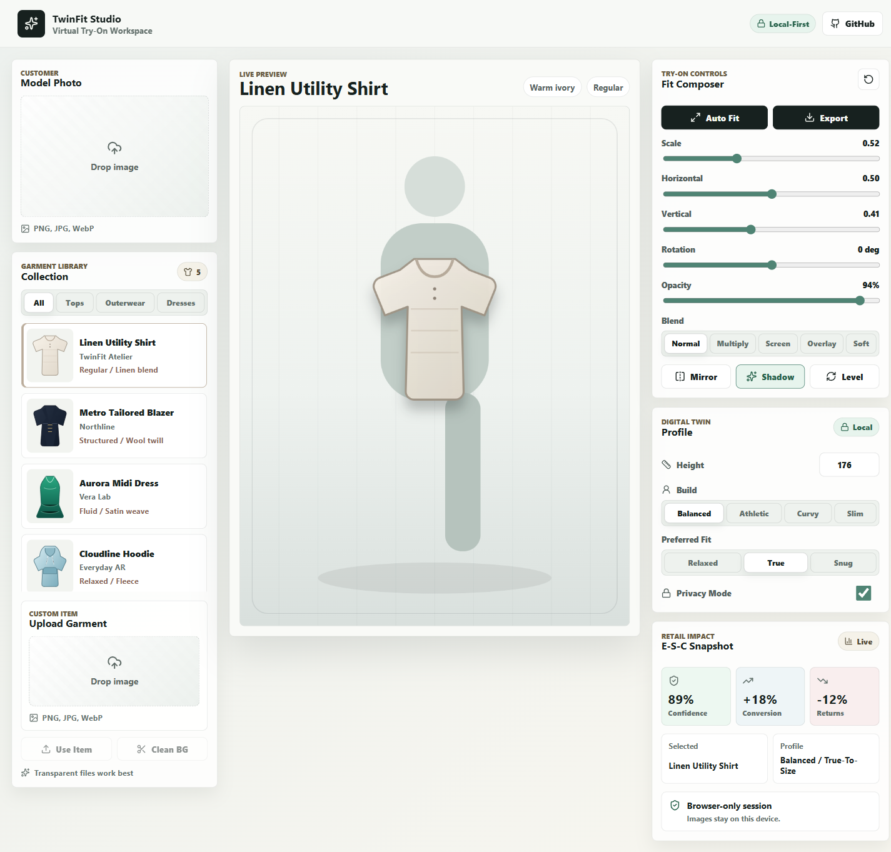

# TwinFit Studio

TwinFit Studio is a professional virtual try-on web app inspired by Hamza El Hilali's master thesis on digital twins, metaverse retail, and virtual try-ons.

The app is local-first: shoppers can upload a photo of themselves, choose or upload a clothing item, position the garment on the body, tune fit and blend settings, and export the result as a PNG. It also includes a digital twin profile and business impact panel aligned with the thesis themes of customer experience, conversion, cost reduction, and privacy.

## Features

- Customer image upload with browser-only processing.
- Built-in clothing catalog plus custom garment upload.
- Interactive try-on canvas with drag, scale, rotation, opacity, blend modes, mirroring, and shadows.
- Light-background cleanup for uploaded garment images.
- Exportable try-on render.
- Digital twin profile inputs for fit preference and shopper segment.
- Thesis-inspired retail impact metrics.
- Responsive professional dashboard UI.

## Preview



## Getting Started

```bash
npm install
npm run dev
```

Then open the local URL printed by Vite.

## Production Build

```bash
npm test
npm run build
```

## Notes

This version performs deterministic browser compositing instead of sending images to a paid AI service. The UI and state model are structured so an AI virtual try-on provider can be added behind the same upload and result workflow later.
